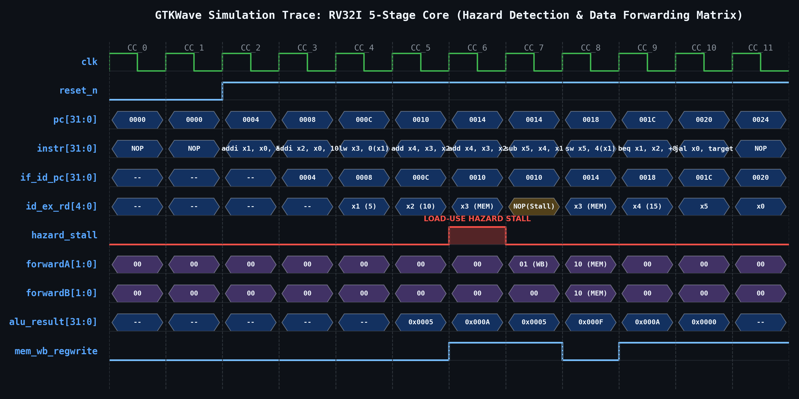

# 5-Stage Pipelined RISC-V (RV32I) Processor Core


A synthesizable, 32-bit 5-stage pipelined processor implementing the base RISC-V (`RV32I`) integer instruction set architecture in SystemVerilog. Designed with full hazard detection, dynamic forwarding paths, and deterministic pipeline flush control.

## Microarchitecture Highlights
- **5-Stage Execution Pipeline:** Clean separation across Instruction Fetch (`IF`), Instruction Decode (`ID`), Execute (`EX`), Memory Access (`MEM`), and Write-Back (`WB`).
- **Dynamic Data Forwarding Matrix:** Eliminates RAW (Read-After-Write) data hazards by routing ALU results directly from `EX/MEM` and `MEM/WB` pipeline registers back into `EX` stage operands.
- **Load-Use Hazard Interlock:** Hardware stall controller automatically inserts single-cycle pipeline bubbles when an instruction immediately depends on a preceding `LW` memory read.
- **Control Hazard Resolution:** Deterministic branch target evaluation with automated pipeline stage flushing on taken conditional branches (`BEQ`).

## Verification & Waveform Analysis
The core was verified using a self-checking SystemVerilog testbench executing back-to-back arithmetic dependencies, load-use stalls, and memory stores:



## Quick Start (Simulation)
```bash
# Compile and execute testbench
make sim_rv32i

# Launch waveform viewer
make wave_rv32i
